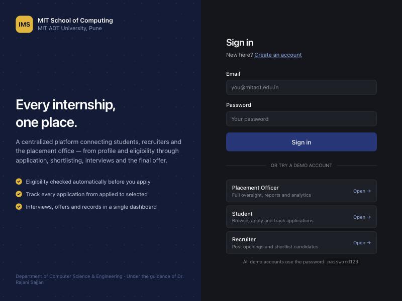
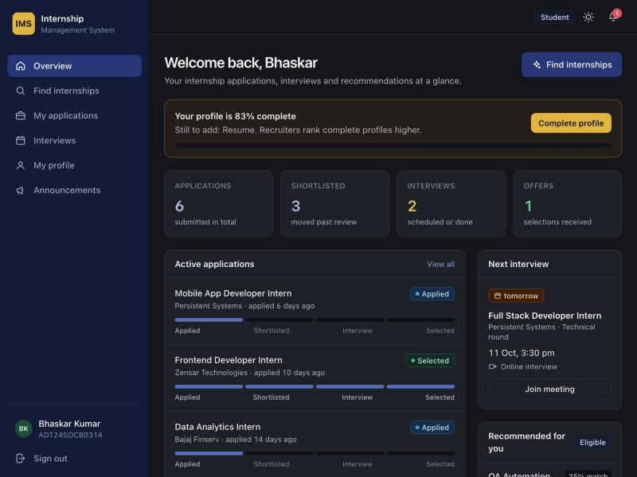
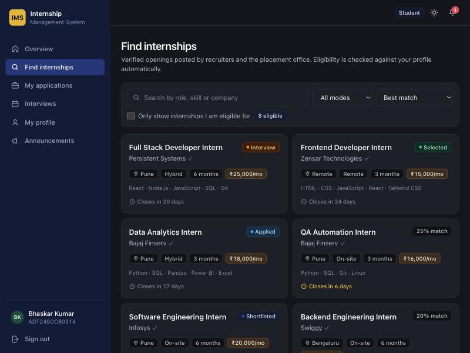
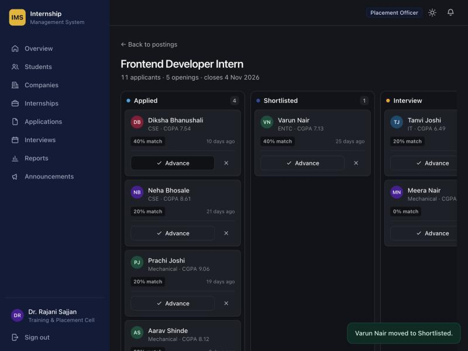
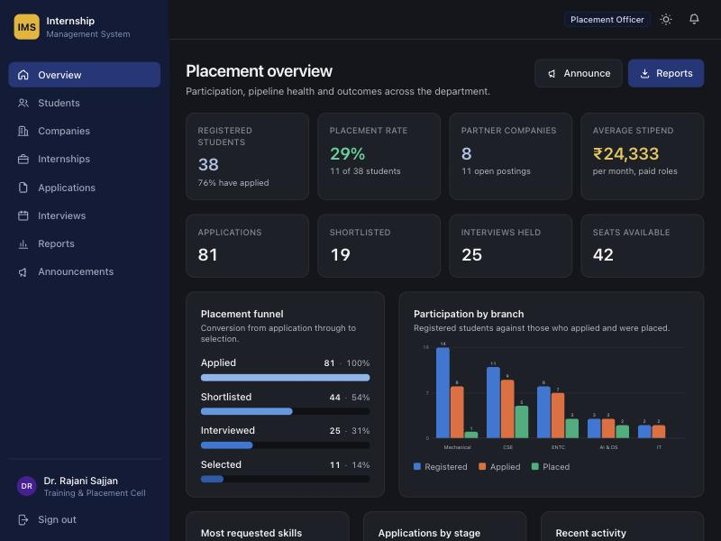
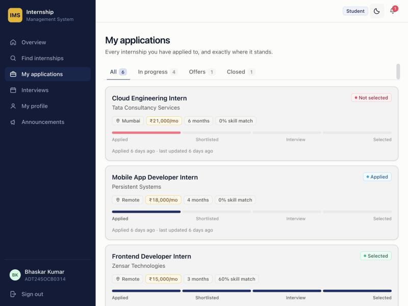
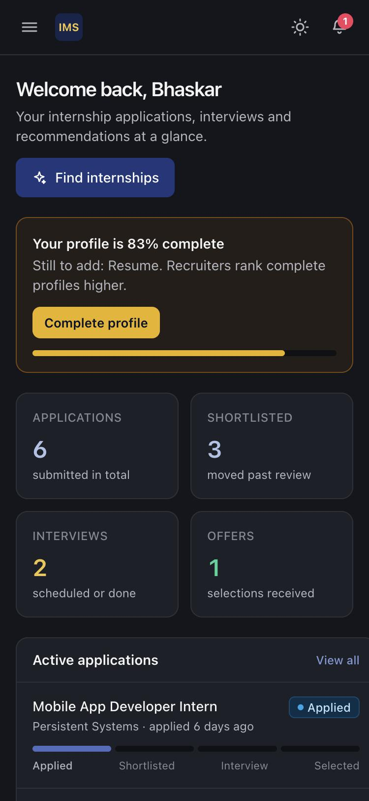

# Internship Management System

**A centralized platform for the student internship application and campus placement process.**

Students register a profile, see only the openings they are actually eligible for, apply online and
track every application from *applied* through to *selected*. Recruiters post openings, shortlist
candidates on a drag-and-drop board and schedule interviews. The placement office oversees the whole
process from one dashboard and exports the records it needs for reporting.

> Project-Based Learning submission — Department of Computer Science & Engineering,
> MIT School of Computing, MIT ADT University, Pune.
> **Group ID:** TYCC306 · **Guide:** Dr. Rajani Sajjan

---

## Contents

- [Quick start](#quick-start)
- [Demo accounts](#demo-accounts)
- [Screenshots](#screenshots)
- [What it does](#what-it-does)
- [Tech stack](#tech-stack)
- [Project structure](#project-structure)
- [How the key algorithms work](#how-the-key-algorithms-work)
- [API reference](#api-reference)
- [Database schema](#database-schema)
- [Running with Docker](#running-with-docker)
- [Tests](#tests)
- [Configuration](#configuration)
- [Team](#team)

---

## Quick start

You need **Node.js 18 or newer**. Nothing else — no database server, no Docker, no API keys.

```bash
git clone https://github.com/CTAGRAM/internship-management-system.git
cd internship-management-system
npm install
npm start
```

Then open **<http://localhost:4000>**.

On its first run the app creates a SQLite database and fills it with realistic demo data
(38 students, 8 companies, 12 internships, ~80 applications across every pipeline stage), so there
is something to look at immediately.

### Development mode

Runs the API and the Vite dev server together, with hot reload on both:

```bash
npm run dev
```

The UI is on <http://localhost:5173> and proxies `/api` to the server on port 4000.

### Useful commands

| Command | What it does |
| --- | --- |
| `npm start` | Build the frontend and serve everything on one port (production mode) |
| `npm run dev` | API + frontend with hot reload |
| `npm run build` | Build the frontend into `web/dist` |
| `npm run seed` | Load demo data (only if the database is empty) |
| `npm run reset` | Wipe the database and reload fresh demo data |
| `npm test` | Run the test suite |

---

## Demo accounts

All demo accounts use the password **`password123`**. The sign-in page has one-click buttons for
each of them, so you do not need to type anything.

| Role | Email | What you can do |
| --- | --- | --- |
| **Placement Officer** | `tpo@mitadt.edu.in` | Full oversight: students, companies, every application, reports and CSV exports, announcements |
| **Student** | `bhaskar.kumar@mitadt.edu.in` | Browse and filter openings, see live eligibility, apply, track applications, respond to offers |
| **Recruiter** | `hr@persistentsy.com` | Post openings, shortlist on the pipeline board, schedule interviews, make offers |

The other three project authors also have student logins — `arman.singh@mitadt.edu.in`,
`ayush@mitadt.edu.in` and `diksha.bhanushali@mitadt.edu.in` — each with a different mix of
application stages.

---

## Screenshots

| | |
| --- | --- |
|  **Sign in** — one-click demo accounts |  **Student dashboard** — pipeline, next interview, recommendations |
|  **Find internships** — match score and eligibility per card |  **Shortlisting board** — drag candidates between stages |
|  **Placement overview** — funnel, branch participation, analytics |  **Application tracker** — light theme |

<p align="center">
  
  <br><em>Every screen works down to 375&nbsp;px.</em>
</p>

---

## What it does

The ten modules from the project synopsis, and where each one lives in the app.

| # | Module | Implemented as |
| --- | --- | --- |
| 1 | **Student Registration & Profile** | Self-registration with enrolment number; profile with academics, skills, projects, certifications, links and resume upload (PDF/Word, 5 MB) |
| 2 | **Company Management** | Placement officer registers and verifies companies; recruiters maintain their own company page |
| 3 | **Internship Management** | Postings with description, responsibilities, skills, stipend, duration, openings, location, work mode and deadline |
| 4 | **Eligibility & Recommendation** | Every posting is scored against the signed-in student's profile; ineligible ones say exactly *why*, and a "best match" sort ranks by skill overlap |
| 5 | **Application Management** | One-click apply with an optional cover note; eligibility is re-checked server-side; students track status and can withdraw while still under review |
| 6 | **Shortlisting** | Drag-and-drop pipeline board per posting, plus bulk shortlist/reject from the applicant table |
| 7 | **Interview Management** | Schedule rounds with date, mode, venue or meeting link and instructions; rescheduling re-notifies the student |
| 8 | **Selection & Offer** | Recruiters record selection with stipend and joining date; the student accepts or declines in-app |
| 9 | **Notification** | In-app notification centre with unread badge, fired on new eligible postings, status changes, interviews and offers; plus placement-office announcements |
| 10 | **Dashboard & Reporting** | Role-specific dashboards, a placement funnel, branch-wise participation, top skills, recruiter league table, activity feed, and four CSV exports |

### Beyond the synopsis

- **Light and dark themes**, remembered per browser and defaulting to the OS setting.
- **Fully responsive** — the sidebar becomes a drawer, tables collapse columns, the pipeline board scrolls horizontally.
- **Accessible by default** — status is never colour alone (every pill carries a dot *and* a label), charts ship direct labels and legends, focus rings appear for keyboard users only, and dialogs trap Escape.
- **Role-scoped data** — a recruiter can only ever see and act on their own company's postings and applicants. This is enforced on the server, not just hidden in the UI.

---

## Tech stack

| Layer | Choice | Why |
| --- | --- | --- |
| Frontend | React 18 + TypeScript + Vite | The stack named in the synopsis, with types to catch mistakes at build time |
| Styling | Tailwind CSS 3 | Design tokens as CSS variables, so light/dark swap in one place |
| Charts | Hand-written SVG | No charting dependency; ~200 lines, and the colour palette is validated for colour-blind separation |
| Backend | Node.js + Express | The stack named in the synopsis |
| Database | SQLite via `better-sqlite3` | **This is the one deliberate deviation from the synopsis** (which said MongoDB/MySQL) — see below |
| Auth | JWT + bcrypt (`bcryptjs`) | Stateless tokens, hashed passwords, role claims |
| Uploads | Multer | Resume storage on disk with type and size limits |

### Why SQLite instead of MongoDB or MySQL

The synopsis specifies MongoDB or MySQL. This build uses SQLite, which is still a real relational
database with the same schema, foreign keys and SQL — it just lives in a file instead of a server
process. That trade buys one important thing: **`npm install && npm start` works on any machine with
no setup at all.** No database to install, no service to start, no connection string to paste, nothing
to go wrong during a demo or an evaluation.

Every query is ordinary SQL in `server/src/routes/`, so porting to MySQL is mostly a driver swap.
`bcryptjs` and `better-sqlite3` were chosen over `bcrypt` and native drivers for the same reason:
they install from prebuilt binaries and need no compiler.

---

## Project structure

```
internship-management-system/
├── server/                     # Express API
│   ├── src/
│   │   ├── index.js            # App entry: middleware, routes, static hosting
│   │   ├── db.js               # SQLite connection, applies schema on boot
│   │   ├── schema.sql          # Full relational schema, safe to re-run
│   │   ├── auth.js             # JWT signing, password hashing, role guards
│   │   ├── util.js             # Eligibility rules, match scoring, notifications, CSV
│   │   ├── seed.js             # Deterministic demo data
│   │   └── routes/             # One file per resource
│   ├── test/                   # Unit tests for the eligibility rules
│   ├── data/                   # SQLite file (git-ignored, created on first run)
│   └── uploads/                # Uploaded resumes (git-ignored)
├── web/                        # React frontend
│   └── src/
│       ├── lib/                # API client, auth context, formatters, hooks
│       ├── components/         # UI kit, app shell, charts, icons
│       └── pages/              # student/ · recruiter/ · admin/ · shared/
├── docs/screenshots/
├── Dockerfile · docker-compose.yml
└── package.json                # npm workspaces, top-level scripts
```

---

## How the key algorithms work

### Eligibility matching

`evaluateEligibility(student, internship)` in [`server/src/util.js`](server/src/util.js) checks five
criteria and returns **every** failing reason, not just the first — so the student sees the complete
picture rather than fixing one problem at a time:

1. CGPA at or above the posting's minimum
2. Active backlogs at or below the maximum
3. Branch in the allowed list (an empty list means all branches)
4. Year of study in the allowed list (empty means all years)
5. The posting is open and its deadline has not passed

The same function runs in two places: to decorate the internship list a student browses, and again on
the server when they actually apply. **The second check is the one that matters** — the UI can be
bypassed, the API cannot.

### Skill match scoring

`skillMatchScore` returns the percentage of a posting's required skills that appear on the student's
profile, case-insensitively. It drives the "best match" sort for students and orders the candidate
board for recruiters. The score is also snapshotted onto the application row at apply time, so later
profile edits do not rewrite history.

### Application tracking

Every status change writes a row to `application_events` with the old status, the new status, a note
and who made the change. That table is what renders the student's progress timeline and the
placement officer's activity feed — the pipeline is an append-only log, not just a column.

### Chart colours

The categorical palette (blue `#2a78d6`, orange `#eb6834`, aqua `#1baf7a`) was checked with a
colour-separation validator rather than picked by eye: it clears the all-pairs colour-blind and
normal-vision separation thresholds in both light and dark themes. Aqua falls below 3:1 contrast on
the light surface, so every bar carries a visible value label as well.

---

## API reference

All endpoints are under `/api`. Everything except `/auth/*` and `/companies/public` needs an
`Authorization: Bearer <token>` header.

<details>
<summary><strong>Authentication</strong></summary>

| Method | Path | Role | Description |
| --- | --- | --- | --- |
| `POST` | `/auth/register` | public | Register as a student or recruiter |
| `POST` | `/auth/login` | public | Exchange credentials for a JWT |
| `GET` | `/auth/me` | any | Current user plus their student or company record |

</details>

<details>
<summary><strong>Students</strong></summary>

| Method | Path | Role | Description |
| --- | --- | --- | --- |
| `GET` | `/students` | admin, recruiter | Search and filter the student pool |
| `GET` | `/students/:id` | self, staff | One profile |
| `PUT` | `/students/:id` | self, admin | Update a profile |
| `POST` | `/students/:id/resume` | self | Upload a resume (multipart) |
| `GET` | `/students/:id/resume` | self, staff | Download a resume |

</details>

<details>
<summary><strong>Companies</strong></summary>

| Method | Path | Role | Description |
| --- | --- | --- | --- |
| `GET` | `/companies` | any | List with posting and application counts |
| `GET` | `/companies/public` | public | Names only, for the signup dropdown |
| `POST` | `/companies` | admin | Register a company |
| `PUT` | `/companies/:id` | admin, own recruiter | Update (only admins may set `verified`) |
| `DELETE` | `/companies/:id` | admin | Remove a company |

</details>

<details>
<summary><strong>Internships</strong></summary>

| Method | Path | Role | Description |
| --- | --- | --- | --- |
| `GET` | `/internships` | any | Search, filter and sort. For students, each row is decorated with eligibility, reasons, match score and their application status |
| `GET` | `/internships/:id` | any | One posting, decorated the same way |
| `POST` | `/internships` | recruiter, admin | Create a posting and notify every eligible student |
| `PUT` | `/internships/:id` | owner, admin | Update |
| `DELETE` | `/internships/:id` | owner, admin | Delete |
| `GET` | `/internships/:id/candidates` | owner, admin | The shortlisting board data |

</details>

<details>
<summary><strong>Applications, interviews, notifications, reports</strong></summary>

| Method | Path | Role | Description |
| --- | --- | --- | --- |
| `GET` | `/applications` | any | Scoped by role: own / company's / all |
| `GET` | `/applications/:id` | own, staff | Detail with timeline and interviews |
| `POST` | `/applications` | student | Apply (eligibility enforced) |
| `PATCH` | `/applications/:id/status` | staff; student for offers | Move a stage, or accept/decline an offer |
| `PATCH` | `/applications/bulk/status` | recruiter, admin | Bulk shortlist or reject |
| `DELETE` | `/applications/:id` | own (while applied), admin | Withdraw |
| `GET` | `/interviews` | any | Schedule, scoped by role |
| `POST` | `/interviews` | recruiter, admin | Schedule a round and advance the application |
| `PUT` | `/interviews/:id` | owner, admin | Reschedule or record the outcome |
| `DELETE` | `/interviews/:id` | owner, admin | Cancel |
| `GET` | `/notifications` | any | Inbox with unread count |
| `PATCH` | `/notifications/:id/read`, `/read-all` | any | Mark read |
| `GET` | `/notifications/announcements/all` | any | Placement-office notices |
| `POST` | `/notifications/announcements` | admin | Broadcast to an audience |
| `GET` | `/reports/summary` | admin | Everything on the placement overview |
| `GET` | `/reports/recruiter` | recruiter | Company-level numbers |
| `GET` | `/reports/student` | student | Personal snapshot |
| `GET` | `/reports/export/:kind` | admin | CSV: `applications`, `placements`, `students`, `internships` |

</details>

---

## Database schema

Nine tables. The full definition with comments is in
[`server/src/schema.sql`](server/src/schema.sql).

```
users ───┬── students ──────────┐
         │                      ├── applications ──┬── application_events
         └── company_users      │                  └── interviews
                   │            │
              companies ── internships
         notifications    announcements
```

**Application status** moves through:

```
applied → shortlisted → interview_scheduled → selected → offer_accepted → completed
    └──────────────────────┴─────────────────────→ rejected
                                        selected ──→ offer_declined
```

---

## Running with Docker

```bash
docker compose up --build
```

The app is then on <http://localhost:4000>. The database and uploaded resumes persist in named
volumes across restarts. Set a real `JWT_SECRET` in `docker-compose.yml` before putting this
anywhere other than your own machine.

---

## Tests

```bash
npm test
```

17 unit tests covering the eligibility rules and skill-match scoring — the logic that decides who may
apply to what, including each criterion in isolation, the "report every reason" behaviour,
case-insensitive matching and the CSV escaping used by the exports.

---

## Configuration

Every value has a working default, so the app runs with no `.env` at all. To change one, copy
`.env.example` to `.env`:

| Variable | Default | Purpose |
| --- | --- | --- |
| `PORT` | `4000` | Port for the API and the built frontend |
| `JWT_SECRET` | a development value | **Set this in production.** Signs auth tokens |
| `DB_PATH` | `server/data/ims.db` | SQLite database location |
| `NODE_ENV` | `development` | Standard Node environment flag |

---

## Team

**Group ID TYCC306** — TY CSE, MIT School of Computing, MIT ADT University, Pune

| Enrolment No. | Name | Division |
| --- | --- | --- |
| ADT24SOCB0201 | Arman Singh | TY FCC-2 |
| ADT24SOCB0376 | Diksha Bhanushali | TY FCC-3 |
| ADT24SOCB0291 | Ayush | TY FCC-3 |
| ADT24SOCB0314 | Bhaskar Kumar | TY FCC-3 |

Under the guidance of **Dr. Rajani Sajjan**, Department of Computer Science & Engineering.

## License

[MIT](LICENSE)
